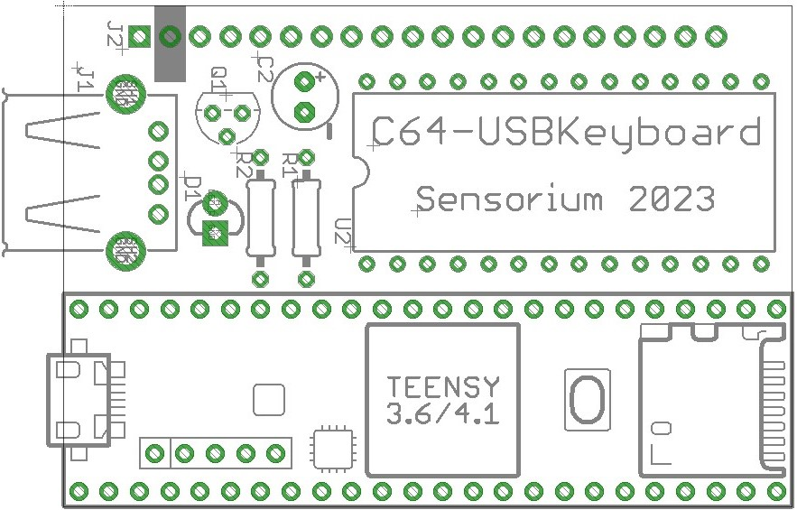

# C64 USB Keyboard PCB Assembly Instructions:

If there are additional questions, feel free to [contact me](mailto:travis@sensoriumembedded.com).

## Tools/materials needed:
- Soldering iron/Solder (lead-free or otherwise)
- Wire cutters (aka Side Cutters, Dykes)
- Small knife (e.g. X-Acto)
- Computer with [Arduino](https://www.arduino.cc/en/software) and the [Teensyduino app](https://www.pjrc.com/teensy/td_download.html) loaded.
- Parts listed in the [C64 USB Keyboard BOM](https://github.com/SensoriumEmbedded/C64-USBKeyboard/raw/main/PCB/v0.1%20archive/C64toUSBKeyboard%20BOM.xlsx)
  - Including bare PCB: [Link to design at OSH Park](https://oshpark.com/shared_projects/wqtal8dL)

## Teensy prep:
- **Cut the VUSB–VIN jumper on the bottom of the Teensy (required).** Do this before assembly, since it is on the bottom of the Teensy module. See [this picture](https://raw.githubusercontent.com/SensoriumEmbedded/TeensyROM/main/media/Teensy/T41_pwr_cut.jpg) for a Teensy 4.1; the 3.6 has the same jumper.
  - With the jumper cut, the Teensy powers from the C64 only, so its micro-USB port can stay connected to a computer while the C64 is on. That is how the firmware is updated (with the C64 turned on, powering the Teensy), and how a host program controls the C64 over USB serial.
  - With the jumper intact, the computer's 5v supply drives against the C64's, and back-powers the C64 when it is off.
- Programming the Teensy is done via the micro-USB connector on the Teensy itself, with the C64 turned on.

## PCB Assembly

- All components (except resistors) must be installed in proper orientation/polarity.
  - See silkscreen markings for each component during installation.
  - Capacitor (C2): Negative mark on cap should match negative mark on PCB
  - LED (D1): Square hole = short lead = flat side = Cathode
- Note that the Teensy requires both the two 24 pin headers as well as a 5 pin header to connect to the PCB. The 5 pin header carries the USB host signals to the USB connector **(very important)**.
- The connector to the C64 (J2) is the only one installed from the bottom.
- Optional wiring off the PCB (TOD clock, C64 /RESET, VIC-II Kawari, TeensyROM buttons) is described under [External connections](../README.md#external-connections) in the README.

