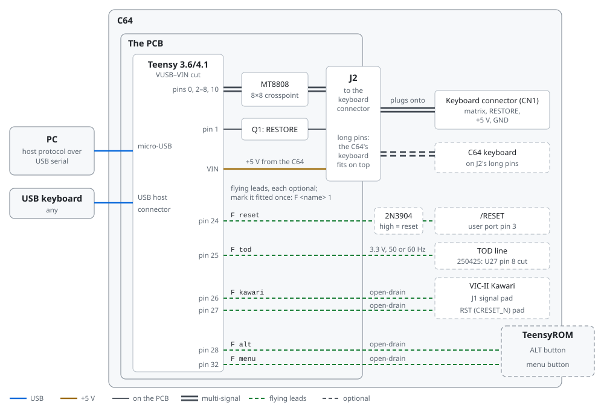
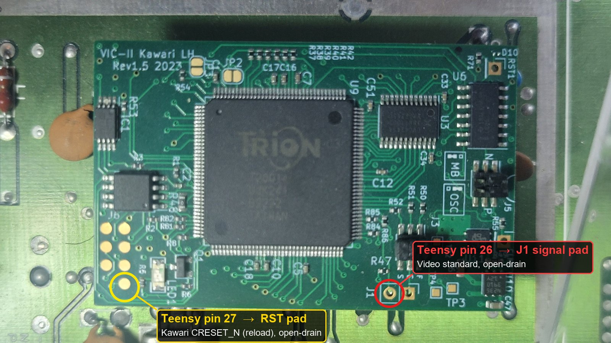
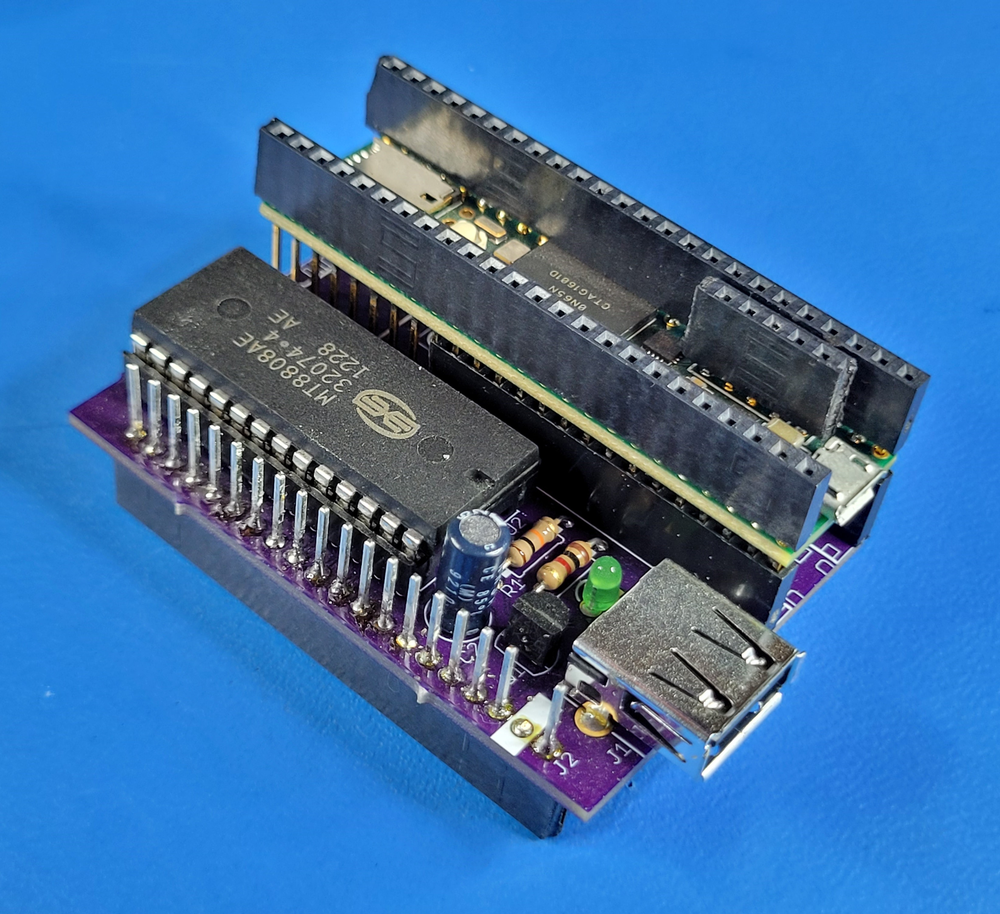
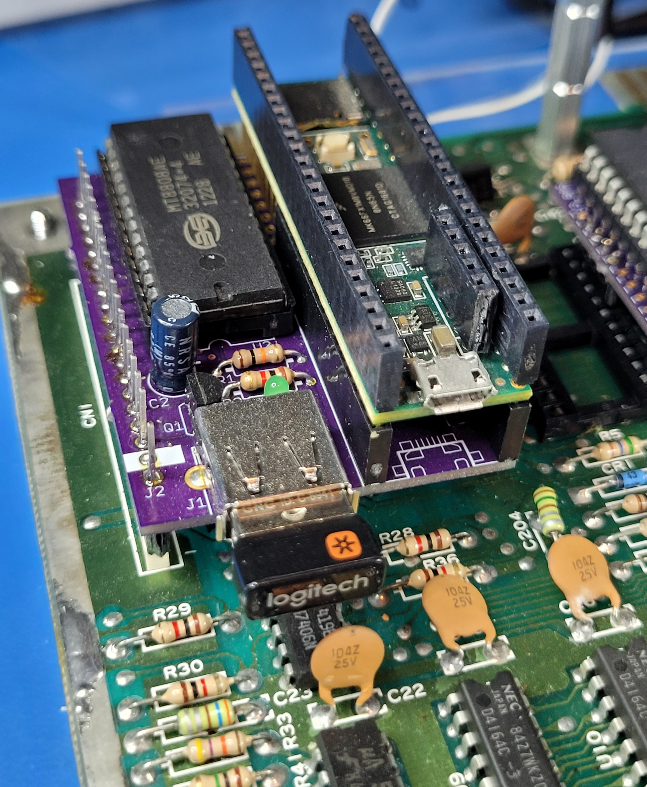

# C64-USBKeyboard

## USB keyboard interface for Commodore 64

A Teensy board inside the C64 that lets a USB keyboard, or a program on a PC, type on the C64.

## Features

- **Real key presses.** The board plugs onto the C64's keyboard connector. An MT8808 crosspoint closes the C64's matrix switches and a transistor drives RESTORE, so the C64 sees what its own keyboard would give it. The original keyboard can stay plugged in on J2's long pins and works alongside.
- **Any USB keyboard.** Each USB key is held on the C64 as long as it's held, and several can be down at once. F2, F4, F6, F8, INST and cursor up/left are sent as their SHIFT combinations, and Caps Lock latches SHIFT.
- **Diagnostics.** F11 emulates the keyboard loopback harness of the C64 diagnostic cartridge. F12 resets the MT8808 to clear a stuck key.
- **Host control over USB serial.** A program on a PC (TReadmill, a terminal, a script) can hold and press keys, type text, press RESTORE, reset the C64, switch a VIC-II Kawari between NTSC and PAL, press the TeensyROM's menu and ALT buttons, set the TOD clock and run timed sequences. The USB keyboard keeps working during a host session.
- **Optional outputs.** TOD clock (50/60 Hz), C64 /RESET, Kawari video standard, TeensyROM menu and ALT buttons. Each is wired off the PCB and turned on per board.
- **Safe start.** At power-on the matrix is open and every output is released within milliseconds; a fitted TOD clock starts at 50 Hz. Everything a host holds is released when it closes its port, and keys and /RESET held by a host are released after at most 10 s.
- **Teensy 3.6 or 4.1.** One firmware for both.
- **Open hardware.** Eagle schematic and board, gerbers, BOM, and the bare PCB at OSH Park.

## USB keyboard controls

Letters, digits, SPACE, RETURN and `- = ; , . /` type the same C64 key. SHIFT works as on the C64, so shifted symbols follow the C64's legends: SHIFT+2 types `"`.

| USB key | On the C64 |
|---|---|
| Esc | RUN/STOP |
| Tab | RESTORE |
| Caps Lock | Latches SHIFT on or off |
| Ctrl | CTRL |
| Windows | C= |
| F1 to F8 | F1 to F8. F2, F4, F6 and F8 are SHIFT+F1, F3, F5 and F7 |
| Backspace, Delete | INST/DEL |
| Insert | SHIFT+INST/DEL |
| Home | CLR/HOME |
| Arrows | CRSR keys. Up and left are sent with SHIFT |
| `'` | `:` |
| `` ` `` | `@` |
| `[`, `]` | `[`, `]` (SHIFT+`:`, SHIFT+`;`) |
| `\` | £ |
| Keypad 4, keypad 8 | ←, ↑ |
| Keypad `*`, `-`, `+` | `*`, `-`, `+` |
| F9 | Toggles the TOD clock between 50 and 60 Hz (needs `tod`, below) |
| F10 | Presses the TeensyROM menu button for 50 ms (needs `menu`, below) |
| F11 | Loopback for the C64 diagnostic cartridge, until F12 |
| F12 | Resets the MT8808: releases every USB keyboard key, Caps Lock and the loopback. Keys a host holds stay down |

## External connections



The matrix, RESTORE and the LED are on the PCB. These lines are wired off it, and each is optional:

| Function | Teensy pin | Drive | Connects to | `F` name | Used by |
|---|---:|---|---|---|---|
| TOD clock | 25 | 50 or 60 Hz square wave, 3.3 V | The C64's TOD line. On a 250425 board, U27 pin 8, cut (see below) | `tod` | F9, `T` |
| C64 /RESET | 24 | High = reset, through an off-board 2N3904 | /RESET; user port pin 3 is the easiest point | `reset` | `R`, `X`, `V` |
| Kawari video standard | 26 | Open-drain | Kawari J1 signal pad | `kawari` | `V` |
| Kawari reload | 27 | Open-drain | Kawari RST (CRESET_N) pad | `kawari` | `V` |
| TeensyROM ALT button | 28 | Open-drain | TeensyROM ALT button | `alt` | `B alt`, `X` |
| TeensyROM menu button | 32 | Open-drain | TeensyROM menu button | `menu` | F10, `B menu`, `X` |

- **Mark each wired line fitted, once.** The board drives only the lines marked fitted in its EEPROM, and nothing is marked on a new board. Until a line is marked, its key does nothing and its host commands answer `ERR notfitted`. From any serial terminal on the Teensy's USB port, send `F <name> 1` for each line you wired, for example `F tod 1` and `F menu 1`. `F ?` lists them. The marks survive power-off and firmware updates.
- **TOD** on a 250425 long board: cut pin 8 of U27 and wire pin 25 to the PCB side of the cut, not the U27 side. The C64's own TOD source no longer reaches the line, so its TOD clock runs only while `tod` is fitted and set to 50 or 60 Hz. Other board revisions may be different.
- **/RESET** goes through a transistor because the C64 pulls it up to 5 V: 10 kΩ from pin 24 to the base of a 2N3904, emitter to GND, collector to /RESET. Add 100 kΩ from the base to GND, so the C64 isn't reset while the Teensy is being flashed.
- **Open-drain lines** (Kawari and TeensyROM buttons) are direct wires. The Teensy only pulls them low, and the target's own 3.3 V pull-up sets the high level. Never drive them high.
- **Kawari:** `V` holds the C64 in reset, sets J1 and reloads the Kawari, so switching the video standard always resets the C64. It needs both `kawari` and `reset`. J1 is released at the next power-on, and the Kawari comes up in its saved model.

||
|:--:|
|Kawari Mini (Rev1.5) connection points: Teensy pin 27 to the RST (CRESET_N) programming pad, pin 26 to J1's signal pad|

## Host control over USB serial

The Teensy's USB port is a serial port that a program on a PC uses to drive the C64. **[Docs/Host_Protocol.md](Docs/Host_Protocol.md)** is the full contract, and the firmware and its hosts are tested against it. In short:

- The board's USB serial string is `C64USBKeyboard_<chipid>` and its product string `C64 USB Keyboard`, so a host finds the board without opening any port.
- The baud rate is ignored, but never open the port at 134 baud, which reboots a Teensy into its bootloader.
- The host asserts DTR, as most terminals do. When it closes the port, the board releases everything the host was holding.
- One command per line, and one reply line for each: `OK <CMD> ...` or `ERR <CMD> <reason>`.
- The board powers from the C64 (the Teensy's VUSB–VIN pad is cut, see [PCB assembly](PCB/PCB_Assembly.md)), so the port is there only while the C64 is on.

| Commands | For |
|---|---|
| `K`, `P`, `S`, `ST`, `X` | Hold, press or type keys; timed sequences |
| `N` | RESTORE |
| `R` | Reset the C64: a pulse, or hold and release |
| `B` | Press the TeensyROM menu or ALT button |
| `T` | TOD clock: 50 Hz, 60 Hz or off |
| `V` | Kawari video standard. Resets the C64 by design |
| `?`, `TIME`, `F`, `E`, `D`, `A` | Identity and state, board clock, fitted lines, key events, loopback, release everything |

```
> S load"$",8{return}
< OK S n=10 t0=83011200 t1=84081320
> R
< OK R t0=85000010 t1=85050018
> V closed
< OK V j1=closed t0=86000012 t1=87001250
```

## Firmware

The sketch is in [Source/C64_keyboard](Source/C64_keyboard). Build it with Arduino and Teensyduino for a Teensy 3.6 or 4.1, USB Type "Serial".

Host protocol tests run on a PC with Node.js and a C++ compiler: `node --test "Source/C64_keyboard/tests/*.test.mjs"`

## PCB and assembly

PCB assembly instructions can be found **[here.](PCB/PCB_Assembly.md)** The design files (Eagle, gerbers, BOM) are in [PCB/v0.1 archive](PCB/v0.1%20archive).

Stand-alone and in-system pictures below. Note that I have sockets above and below the Teensy module in my build. Actual build per BOM using headers will make it sit much lower (similar to the MT8808 chip).

|||
|:--:|:--:|

## Possible future PCB revision

The v0.1 PCB is built and tested, but an update is likely in the future. A v0.2 board could move the hand wiring onto the PCB:

- The /RESET transistor, with its base pull-down. Q1 on RESTORE would get one too. The keyboard connector has no /RESET pin, so /RESET still needs its own lead.
- A connector or pads for the TOD, TeensyROM button and Kawari leads, in place of wires soldered to Teensy pins.
- The MT8808 may be replaced, as shown in the **[MT8808 replacement study](Docs/MT8808_Replacement_Study.md)**. Its last-time buy was 21 May 2026, but it's still available from distributors.

## Contact

Questions?  Send e-mail to [Travis @ Sensorium](mailto:travis@sensoriumembedded.com)

## Credits and license

**Copyright (c) 2023-2026 Sensorium Embedded, Written by Travis Smith**

**C64 Key Position Mapping:**
* [C64keyboard](https://github.com/Hartland/C64-Keyboard) - Commodore Keyboard library
  * Copyright (c) 2022 Hartland PC LLC, Written by Robert VanHazinga

Licensed under the GNU General Public License, version 3 or later. See [LICENSE](LICENSE).
